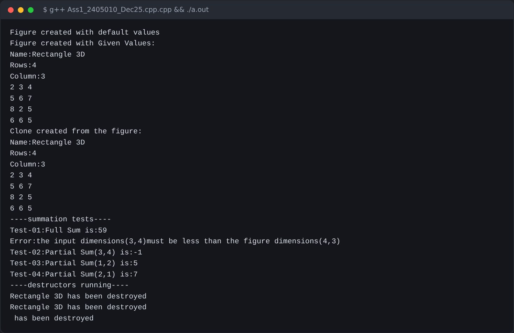
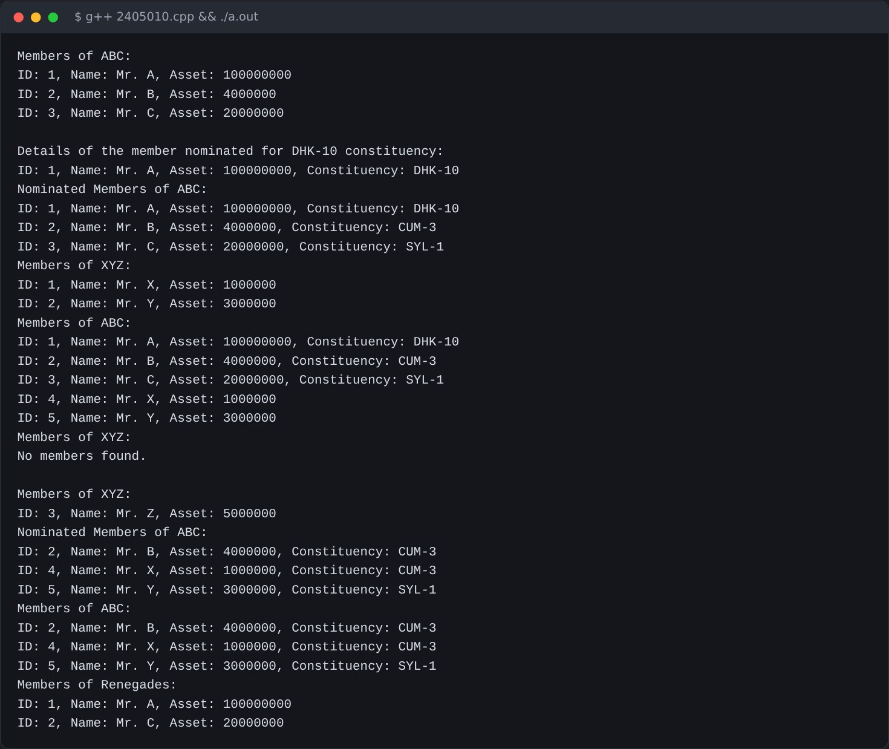
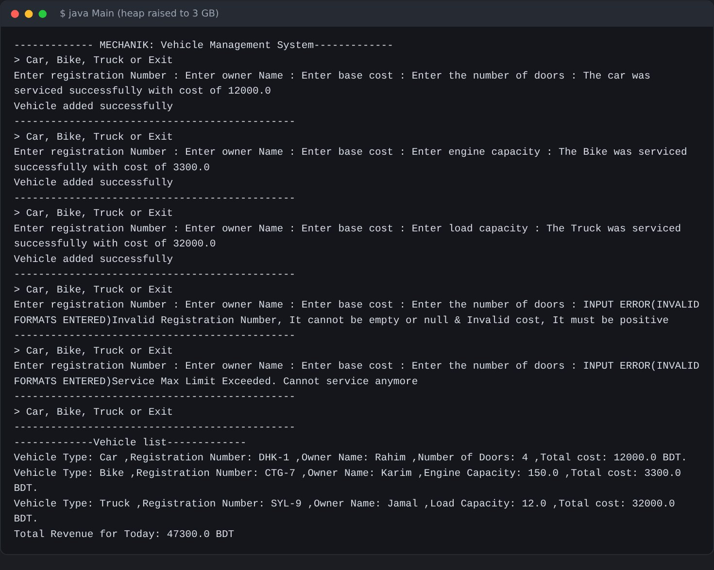
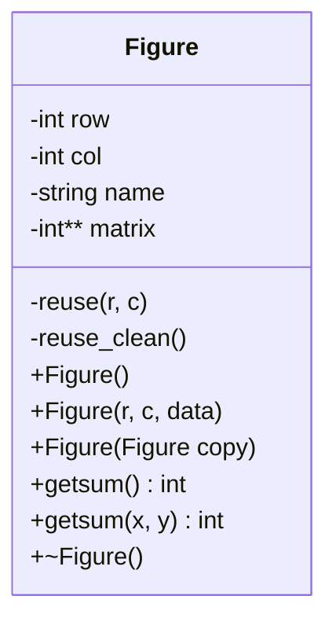
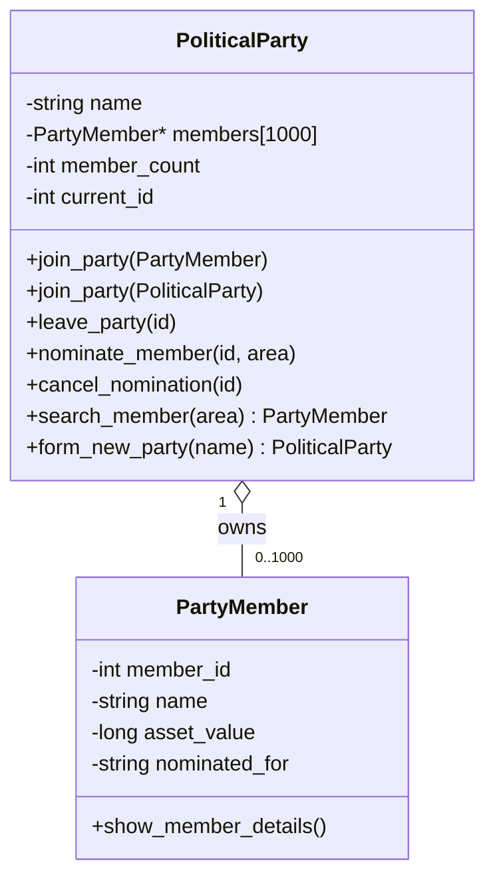
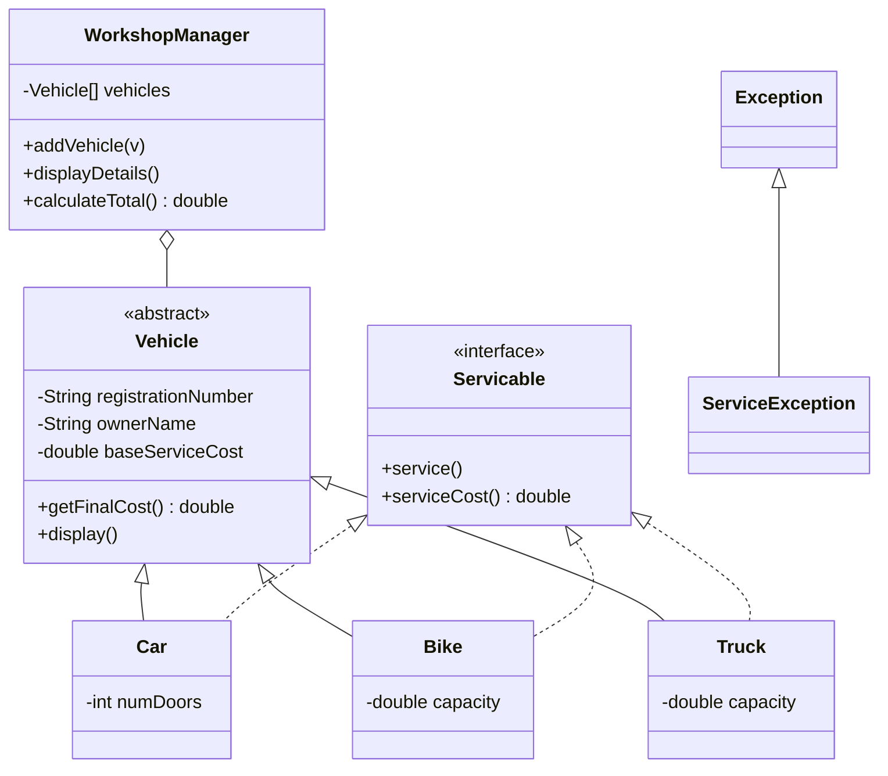
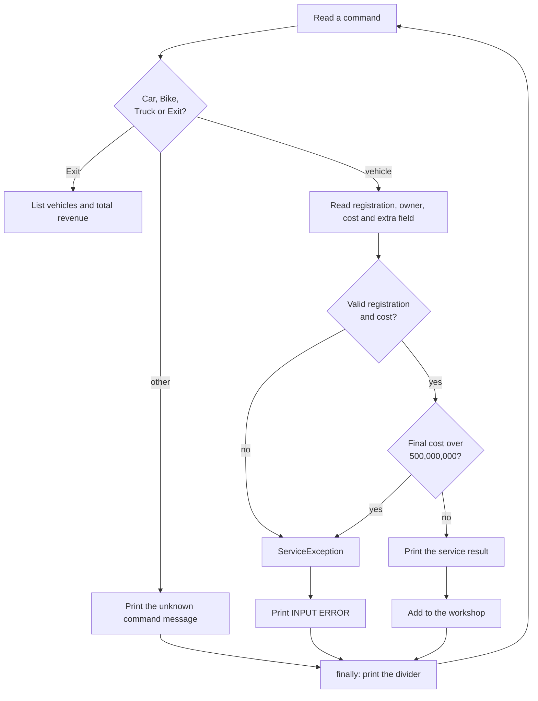
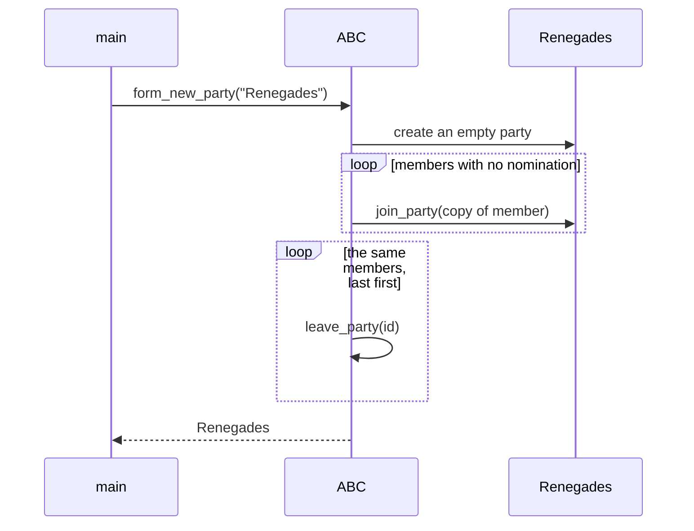

<div align="center">


# Object Oriented Programming

**Three CSE 108 offline assignments, in C++ and Java.**

Constructors and destructors, method overloading with dynamic objects, and
inheritance with interfaces and exceptions.


[Assignments](#assignments) ·
[Design](#design) ·
[Run them](#run-them) ·
[Notes](#notes)

</div>

## At a glance

| | Offline 1 | Offline 2 | Offline 3 |
| --- | --- | --- | --- |
| **Language** | C++ | C++ | Java |
| **Topic** | Encapsulation, constructors, destructor, overloaded `getsum` | Dynamic objects, overloaded constructors, copy constructor, passing and returning objects | Inheritance, interface, custom checked exception |
| **Program** | A `Figure` class holding a matrix of points | An election system with `PartyMember` and `PoliticalParty` | A car workshop with `Car`, `Bike` and `Truck` |
| **Folder** | `Constructor, Destructor And Overloading/` | `Method Overloading/` | `Java Inheritance/` |
| **Deadline** | 12 December 2025 | 9 January 2026 | 6 February 2026 |

Each folder also holds the assignment specification as a PDF or Word file.

## Assignments

### Offline 1: the `Figure` class

A line, a triangle or a rectangle is stored as a matrix: one row per point, one column per dimension. `Figure` owns that matrix as a heap-allocated `int**`, keeps `row`, `col`, `name` and `matrix` private, and names itself from the shape of the matrix.

| Rows x columns | Name |
| --- | --- |
| 2 x 2 / 2 x 3 | Line 2D / Line 3D |
| 3 x 2 / 3 x 3 | Triangle 2D / Triangle 3D |
| 4 x 2 / 4 x 3 | Rectangle 2D / Rectangle 3D |
| anything else | Unknown Figure |

- **Three constructors:** default (empty), parameterised `(r, c, int* data)` which unpacks a 1D array into the matrix, and a clone constructor.
- **Destructor:** prints `<name> has been destroyed`, zeroes every element, frees the rows and the array.
- **Overloaded `getsum`:** `getsum()` adds everything; `getsum(x, y)` adds rows `0..x-1` and columns `0..y-1`, and prints an error and returns `-1` when `x` or `y` is not smaller than the matrix size.
- **Code reuse:** one private `reuse(r, c)` allocates, one private `reuse_clean()` frees, and every constructor and the destructor go through them.

The real output of `main()`, which builds a 4 x 3 rectangle, clones it and runs four sum tests:



### Offline 2: the election system

`PartyMember` holds an id, a name, an asset value and the constituency the member is nominated for. `PoliticalParty` keeps up to 1,000 members in an array of `PartyMember*`, allocating an object only when someone joins and freeing it when they leave. No STL containers are used, as the specification requires.

| Operation | What it does |
| --- | --- |
| `join_party(PartyMember)` | Copies the member in and gives them the next id. Ids are never reused. |
| `join_party(PoliticalParty&)` | Moves every member of the other party over, clears their nominations and empties the other party. |
| `leave_party(id)` | Deletes the member and closes the gap in the array. |
| `nominate_member(id, area)` / `cancel_nomination(id)` | Sets or clears the constituency. |
| `search_member(area)` | Returns the nominated member by value, or an empty `PartyMember`. |
| `form_new_party(name)` | Moves every member who has no nomination into a new party. |
| `show_all_members()` / `show_nominated_members()` | Print in the format of the reference output. |

The output of the supplied `main()`. It matches the expected-output comment in the file line for line, except that the reference leaves a blank line between blocks and the program does not print one:



### Offline 3: the car workshop

A console program, "MECHANIK", that reads vehicles from the keyboard. `Vehicle` is abstract, `Car`, `Bike` and `Truck` extend it, and each also implements the `Servicable` interface.

| Vehicle | Extra field | Service cost |
| --- | --- | --- |
| Car | number of doors | base + doors x 500 |
| Bike | engine capacity | base + capacity x 2 |
| Truck | load capacity | base + capacity x 1000 |

`ServiceException` is a custom checked exception. It is thrown for an empty or null registration number, for a negative base cost (both messages at once if both are wrong), and from `service()` when the cost goes above `MAX_LIMIT`, 500,000,000. `Main` handles it with `try`, `catch` and `finally`, and a vehicle is only added to the workshop after it has been serviced successfully. At the end the program lists every vehicle and prints the total revenue.

A real session: three valid vehicles, a car with an empty registration number and a negative cost, a car whose cost is over the limit, then `Exit`:



## Design

### `Figure` (Offline 1)



### Election system (Offline 2)



### Workshop (Offline 3)



### How a vehicle gets in



### Forming a new party



## Run them

| Assignment | Compile | Run |
| --- | --- | --- |
| Offline 1 | `g++ "Constructor, Destructor And Overloading/Ass1_2405010_Dec25.cpp.cpp" -o figure` | `./figure` |
| Offline 2 | `g++ "Method Overloading/2405010.cpp" -o election` | `./election` |
| Offline 3 | `cd "Java Inheritance/2405010" && javac *.java` | `java -Xmx3g Main` |

Offline 3 needs a bigger heap than the default. `WorkshopManager` allocates an array of 500,000,000 references up front, about 2 GB, so a default JVM stops with `OutOfMemoryError` before the first prompt. Lower `MAX_VEHICLE` in `WorkshopManager.java` if you would rather not raise the heap.

Offline 3 asks for `Car`, `Bike`, `Truck` or `Exit`, then the details one per line. After an error or an unknown command it waits for one more line, so press Enter.

## Repository layout

```text
.
├── Constructor, Destructor And Overloading/
│   ├── Ass1_2405010_Dec25.cpp.cpp
│   └── Offline Assignment 1.docx
├── Method Overloading/
│   ├── 2405010.cpp
│   ├── your_student_no.cpp          the skeleton that came with the assignment
│   └── CSE108_Offline 2_Specifications.pdf
└── Java Inheritance/
    ├── 2405010/
    │   ├── Main.java
    │   ├── Vehicle.java             Vehicle, Car, Bike, Truck and Servicable
    │   ├── WorkshopManager.java
    │   └── ServiceException.java
    └── CSE_108_Offline_3__Inheritance_Interface_Exception_.pdf
```

## Notes

Things found by reading and running the code. The source is unchanged.

- **Offline 1:** the clone constructor allocates a new matrix and prints the original's values, but it never copies them into the clone, so the clone's own elements are uninitialised.
- **Offline 1:** the default constructor makes a zero-size matrix with a null pointer, so `getsum()` on it returns 0.
- **Offline 2:** the specification asks for input validation in functions with arguments. The code does not validate ids, names or constituencies.
- **Offline 2:** the `PoliticalParty` copy constructor reads all 1,000 slots, so copying a party with fewer than 1,000 members would dereference null pointers. `main()` does not trigger it, because gcc builds the returned party in place.
- **Offline 2:** it builds clean under AddressSanitizer and UndefinedBehaviorSanitizer with the supplied `main()`.
- **Offline 3:** the specification asks for a collection. `WorkshopManager` uses a fixed array instead, which is what causes the heap requirement above.
- **Offline 3:** the interface is spelled `Servicable` in the code, and the error text says the cost "must be positive" although zero is accepted.
- The sample outputs above were produced by compiling and running the files in this repository.
